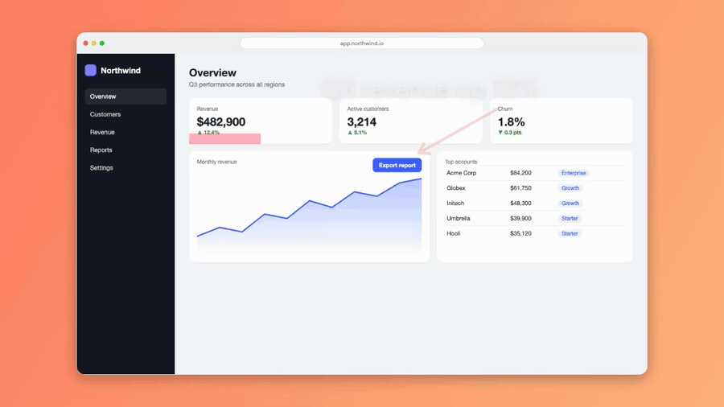
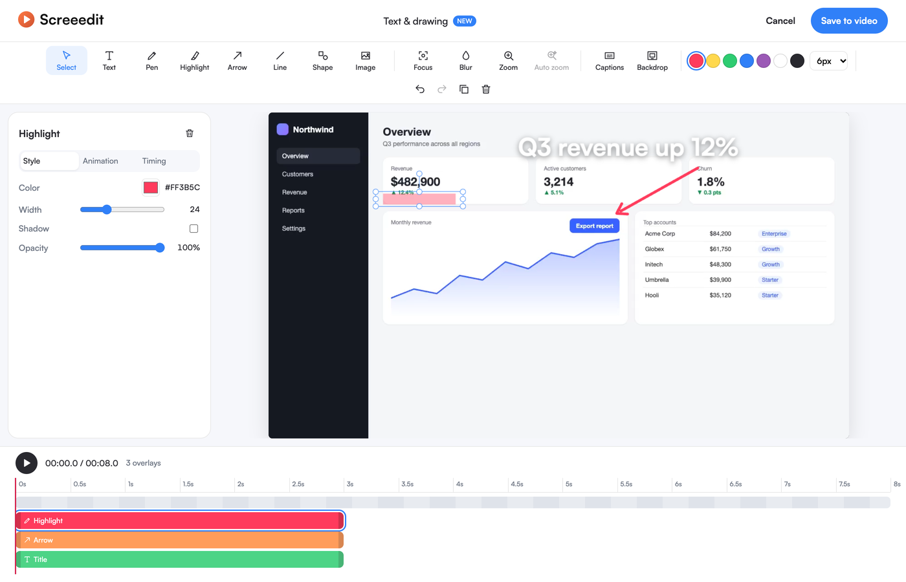
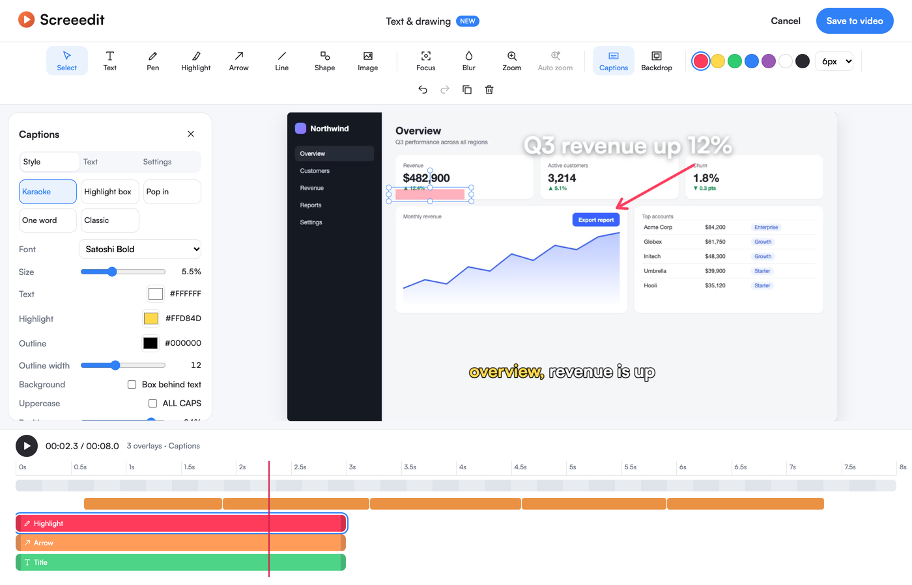
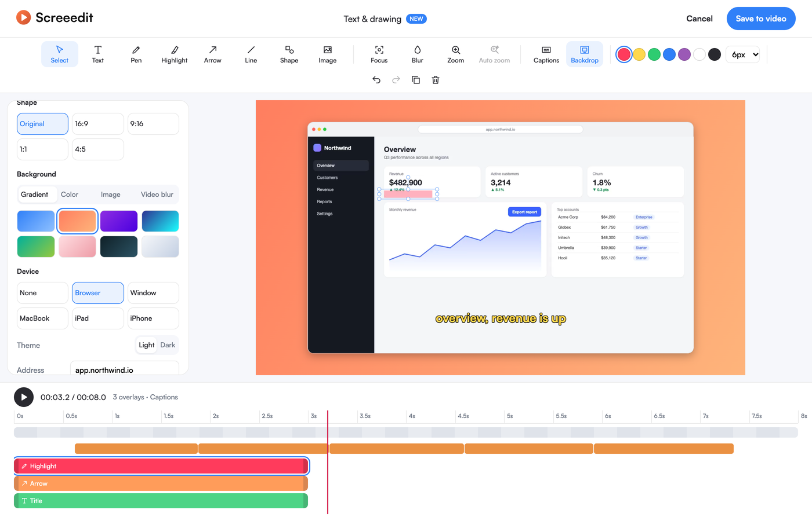
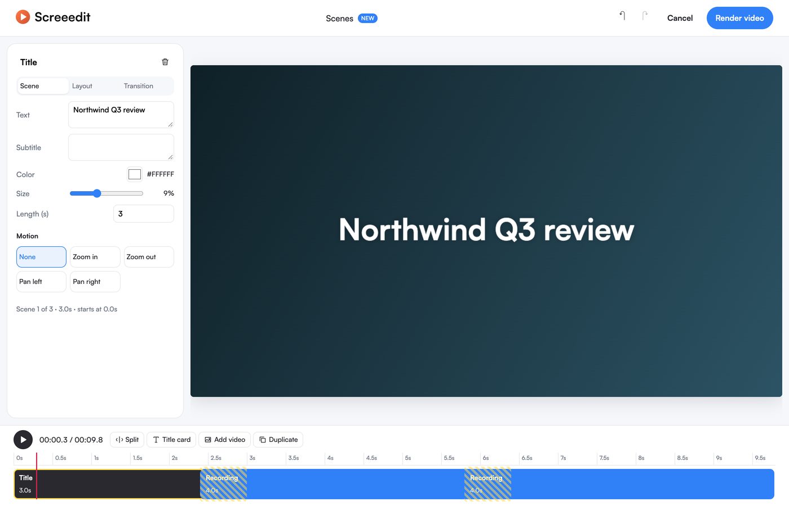
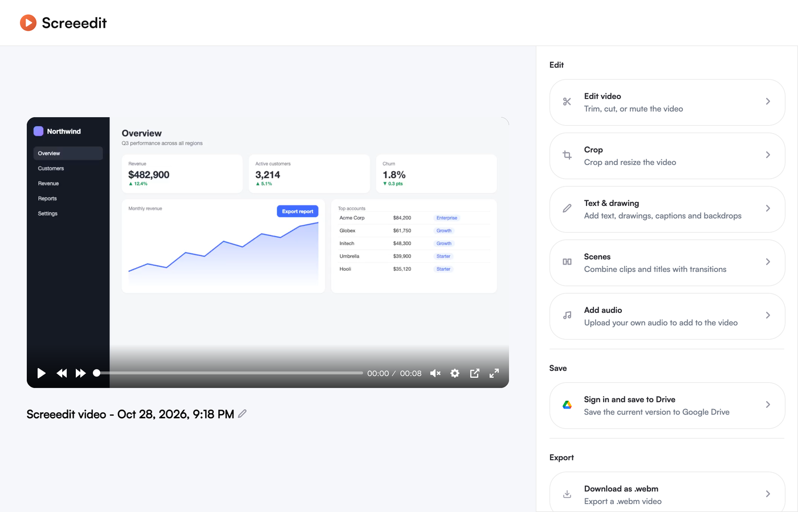

<p align="center">
  <picture>
    <source media="(prefers-color-scheme: dark)" srcset=".github/readme/logo-dark.svg">
    
  </picture>
</p>

<h3 align="center">Record your screen. Edit it like a pro. Never upload a thing.</h3>

<p align="center">
  A Chrome screen recorder with a real video editor built in: captions, text and drawing, backdrops, scenes and auto-zoom, all running on your own computer.
</p>

<p align="center">
  
  
  
  
</p>

<p align="center">
  
</p>

---

## Why Screeedit

Most screen recorders stop at "record". Then you export, open a separate editor, re-import, caption it somewhere else, and upload it to yet another service. Screeedit finishes the job where you recorded it.

- **Private by design.** Recording, editing, speech-to-text and rendering all happen in your browser. Your video stays on your machine unless you download it or save it to your own Google Drive.
- **No account, no watermark.** Install it and start recording; there's nothing to sign up for.
- **Edits stay editable.** After you save text and captions into the video, reopen them and keep adjusting. Screeedit re-renders from the original, so nothing gets drawn on twice.

## What you can do

### Text, drawing and effects on a timeline



Add titles, lower thirds, labels, counters and scrolling credits. Draw with a pen or highlighter, point with arrows, drop in shapes and images. Blur sensitive details, spotlight what matters, or zoom into a region. Every item gets its own bar on the timeline: drag it to move it, stretch it to change how long it stays, and choose how it animates in and out.

### Word-by-word captions



One click turns speech into captions that light up word by word. Speech recognition runs on your computer with OpenAI's Whisper, so your audio never leaves the device. Pick from five styles (karaoke, highlight box, pop-in, one word, classic), fix any word, restyle everything, and export `.srt` or `.vtt` subtitle files. Prefer your own Whisper server? Point Screeedit at it.

### Backdrops and device frames



Make a plain recording look finished. Place it on a gradient, a color, your own image or a blurred copy of the video. Frame it in a browser window, a macOS window, a MacBook, an iPad or an iPhone. Switch to 16:9, 9:16, 1:1 or 4:5 for wherever it's going next.

### Scenes



Build a whole video from parts. Split your recording, add title cards and other videos, drag them into order, and choose how each one hands off to the next: cut, fade, slide, wipe, zoom, or a smooth transition that glides from one layout into the next. Every scene can have its own backdrop and a slow zoom or pan.

### Auto-zoom on your clicks

While you record, Screeedit notes where you click. In the editor, one button turns those clicks into zooms on exactly those spots, panning smoothly from one click to the next. Each zoom is an ordinary timeline item you can adjust.

### Everything a recorder should do



Record a tab, an area, your whole screen, a window or your camera. Capture your microphone and system audio, draw on the screen while you record, and blur your camera background. Trim, cut, crop, add music, then download as MP4, WebM or GIF, or save straight to Google Drive.

## Get started

1. Clone this repository and build it (requires Node.js 24):

   ```bash
   npm install
   npm run build:release
   ```

2. Open `chrome://extensions`, turn on **Developer mode**, click **Load unpacked**, and choose the `build` folder.
3. Click the Screeedit icon in your toolbar and start recording. When you stop, your video opens in the editor.

## For developers

Run `npm start` for a watching development build. The editing features live here:

| Feature | Code |
| --- | --- |
| Text & drawing, captions, backdrops | `src/pages/EditorApp/annotate/`, `src/pages/EditorApp/layout/annotate/` |
| Scenes | `src/pages/EditorApp/annotate/scenes.js`, `src/pages/EditorApp/layout/scenes/` |
| Rendering and export | `src/pages/Editor/utils/annotateVideo.js`, `src/pages/Editor/utils/renderScenes.js` |
| Click log for auto-zoom | `src/pages/Background/messaging/handlers.js`, `src/pages/Content/cursor/trackClicks.js` |

## Credits

**Screeedit is built on [Screenity](https://github.com/alyssaxuu/screenity), created and maintained by [Alyssa X](https://alyssax.com).** Screenity's recorder, its original editor, its annotation tools and most of this codebase are her work. Screeedit started from Screenity 4.7.2 in October 2026 and adds the editing features described above; the full list of changes is in the commit history.

Screeedit is an independent project, not affiliated with or endorsed by Screenity or Alyssa X. Screenity's name and logo belong to their owner. If Screeedit is useful to you, please support the original project too: [Screenity](https://screenity.io), [Screenity Pro](https://screenity.io/pro), or [sponsor Alyssa on GitHub](https://github.com/sponsors/alyssaxuu).

Screeedit also stands on:

- [OpenAI Whisper](https://github.com/openai/whisper) speech recognition (MIT), run in the browser with [Transformers.js](https://github.com/huggingface/transformers.js) (Apache-2.0) and [ONNX Runtime Web](https://github.com/microsoft/onnxruntime) (MIT)
- [Mediabunny](https://github.com/Vanilagy/mediabunny) for decoding and encoding video (MPL-2.0)
- [Fabric.js](https://github.com/fabricjs/fabric.js) for the drawing canvas (MIT)

Every bundled third-party package and its license is listed in [THIRD_PARTY_NOTICES.md](./THIRD_PARTY_NOTICES.md).

## License

Screeedit is licensed under the [GNU General Public License v3.0](./LICENSE), the same license as Screenity. As required by GPL-3.0 §5, this is a modified version of Screenity; the modifications and their dates are recorded in this README and the git history.

<p align="center"><sub>Built by <a href="https://github.com/netdevs-net">NetDevs</a></sub></p>
